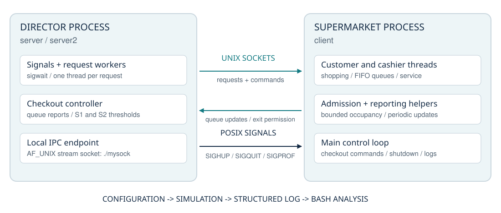

**Author:** Giuseppe Muschetta\
**University:** University of Pisa\
**Degree:** B.Sc. in Computer Science\
**Course:** Operating Systems Laboratory\
**Instructor:** Prof. G. Prencipe\
**Assignment edition:** 2019/2020

# Concurrent Supermarket Simulator

### Processes, threads, queues, and a director making decisions under load.

An Operating Systems Laboratory project written in C: a supermarket becomes a working model of process communication, concurrent activity, shared-state coordination, and resource management. Customers shop and reconsider their queues; cashiers serve baskets and report demand; a separate director decides when checkout capacity should change.

The result brings core operating systems concepts together in one executable system, from `fork` and `exec` to POSIX threads, Unix-domain sockets, condition variables, and coordinated shutdown.

**C99 · POSIX threads · Unix-domain sockets · Signals · Dynamic queues · Bash**

[Technical report](OS-Project-Report.pdf) · [Build and run](#build-and-run) · [Source guide](#source-guide)



## What this project demonstrates

- **A clear process boundary.** The director owns the checkout policy; the supermarket process owns the simulated customers, cashiers, queues, and operational state.
- **An explicit communication protocol.** Integer-coded requests, responses, and acknowledgments travel over local stream sockets, with integer messages converted to network byte order.
- **Concurrency built from the fundamentals.** Customer and cashier threads share state through mutexes and condition variables. The director creates detached workers for accepted requests.
- **A changing workload.** Customer arrivals, basket sizes, checkout choices, queue changes, and cashier availability produce an evolving simulation rather than a fixed sequence of events.
- **Two shutdown paths.** Normal closing stops admission and lets customers finish; emergency closing ends the working day through a separate coordination path.
- **Inspectable results.** A structured log and a Bash analysis script expose customer-level and checkout-level statistics.

## Inside the simulation

At opening time, the supermarket admits `C` customers and starts the configured number of cashiers. Admission resumes when occupancy falls to `C - E` or below, then refills the supermarket to `C` while entry remains allowed.

Each customer selects a shopping duration and a basket size. Customers with an empty basket request the director's permission to leave. Other customers join an open checkout and periodically compare the number of people ahead of them with the lengths of other open queues. A customer can move to a shorter queue; customers displaced by a closed checkout choose another.

Each cashier has a randomly selected base service time of **20–80 ms**, plus a configurable time per product. A reporting thread periodically sends the checkout's customer count to the director.

The director evaluates two thresholds:

| Condition | Action |
|---|---|
| A reported queue reaches `S2` customers | Open an available checkout, if one exists. |
| At least `S1` checkouts have zero or one customer | Close a selected checkout, keeping at least one open. |

The implementation scans checkout state and stops at the **first triggering condition**. Its decision therefore depends on the scan order as well as the thresholds. Commands and acknowledgments coordinate the director's view with the supermarket's state.

## Build and run

Use **Linux**, a C99 compiler such as GCC, GNU Make, and POSIX threads. Run commands from the project root: the socket, executable, configuration, and log paths are relative to that directory.

```bash
make
```

This builds three executables:

| Executable | Role |
|---|---|
| `server` | Director; expects the supermarket process to be started separately. |
| `server2` | Director compiled with `BUILD2`; starts `./client` using `fork` and `exec`. |
| `client` | Supermarket process; receives the configuration pathname from the director. |

For the simplest launch:

```bash
./server2 config2.txt
```

The simulation runs until it receives a closing signal. For a bounded Linux run using GNU `timeout`:

```bash
timeout --foreground --preserve-status -s SIGHUP 25 ./server2 config2.txt
bash analisi.sh resoconto2.log
```

`SIGHUP` requests normal closing after 25 seconds; draining the remaining customers may take additional time. `--foreground` lets the director forward the closing signal to its child.

<details>
<summary><strong>Separate processes, signals, and supplied test targets</strong></summary>

Start the director in one terminal:

```bash
./server config1.txt
```

Then start the supermarket in another terminal, in the same directory:

```bash
./client
```

The director takes an optional configuration pathname; its default is `./config1.txt`. The supermarket takes no command-line arguments.

After startup, send the director:

| Signal | Meaning |
|---|---|
| `SIGHUP` | Close admission and let customers already inside finish. |
| `SIGQUIT` | Request emergency closing. |
| `SIGPROF` | Internal checkout-command coordination; used by the program. |

The supplied Makefile also includes `make test1` and `make test2`. They combine timed execution with log analysis; `test1` additionally uses Valgrind. These are integration workflows, rather than an assertion-based unit test suite. Both targets change the executable permission of `analisi.sh`.

Log analysis requires **Bash, awk, and bc**. GNU `timeout` and Valgrind are required only for the workflows that invoke them.

</details>

## Configuration

Both sample files use the same **12-line format**. The parser reads fixed line positions and the text after `: `; preserve the line order and separators when preparing a configuration.

| Parameter | Meaning | `config1.txt` | `config2.txt` |
|---|---|---:|---:|
| `K` | Maximum number of open checkouts | 2 | 6 |
| `C` | Maximum customers admitted concurrently | 20 | 50 |
| `E` | Departures threshold for admission refill | 5 | 3 |
| `S` | Queue reconsideration interval, ms | 30 | 20 |
| `T` | Maximum shopping duration, ms; greater than 10 | 500 | 200 |
| `P` | Maximum basket size, products | 80 | 100 |
| Initial checkouts | Checkouts open at the start | 1 | 2 |
| Log file | Output pathname | `resoconto.log` | `resoconto2.log` |
| Per-product time | Cashier processing time per product, ms | 2 | 2 |
| Reporting interval | Checkout updates sent to the director, ms | 20 | 20 |
| `S1` | Threshold for closing a checkout | 1 | 2 |
| `S2` | Queue threshold for opening a checkout | 4 | 5 |

These configurations offer two concrete workloads: a compact supermarket with two checkouts and a larger scenario with six.

## Reading the results

After closing, the supermarket writes the configured log. The analysis script turns its line-oriented records into tables.

| Level | Recorded information |
|---|---|
| Overall | Total customers and purchased products |
| Customer | ID, thread ID, purchased products, time inside, recorded checkout-phase time, number of queues joined |
| Checkout | Products processed, customers served, total open time, average nominal service time, closure count |

Configuration durations use **milliseconds**; logged durations are expressed in **seconds**. The customer's recorded checkout-phase time includes service completion and the time until the customer observes that completion. Cashier service statistics use the requested simulation durations. These fields should therefore be interpreted according to the implementation, rather than as independent measurements of pure waiting time or real-world service performance.

## Source guide

| File | Responsibility |
|---|---|
| `server.c`, `server.h` | Director startup, policy, request workers, socket listener, signal forwarding |
| `client.c`, `client.h` | Customer and cashier lifecycle, admission, checkout management, shutdown, logging |
| `shared.c`, `shared.h` | Message vocabulary, shared constants, exact-length I/O loops, integer encoding |
| `queue.c`, `queue.h` | Generic linked queues, arbitrary removal, queue-position lookup |
| `Makefile` | Primary build, two launch variants, test workflows, and cleanup |
| `CMakeLists.txt`, `cmake-build-debug.zip` | Historical IDE/build material; incomplete or stale, rather than an alternative supported build |
| `analisi.sh` | Log parsing, arithmetic, and formatted statistics |

## Documentation and reproducibility

The [technical report](OS-Project-Report.pdf) explains the architecture, protocol, synchronization, configuration, and engineering limitations against the delivered source. The original `Relazione.pdf` and `Traccia_progetto.pdf` preserve the project's academic context in the supplied source folder. Some original documentation uses historical executable names and mentions `SIGALRM`; the supplied implementation uses `server`/`server2`/`client` and **`SIGPROF`**.

An isolated compilation of the supplied Makefile completed on macOS during documentation preparation. This is a **build check**, not a successful simulation run or Linux runtime validation. The source assumes a Linux-sized `sockaddr_un.sun_path` and requires portability work for native macOS execution.

The cashier holds a global mutex during simulated service, so multiple checkout threads do not establish parallel checkout throughput. The program also assumes each configured or computed sleep is below 1,000 ms; the supplied scenarios satisfy this constraint.

This is an academic systems project. Its code offers useful opportunities for further work on thread-argument lifetime, socket lifecycle, shared-state synchronization, and input validation; the technical report discusses these without implying that they were corrected.

